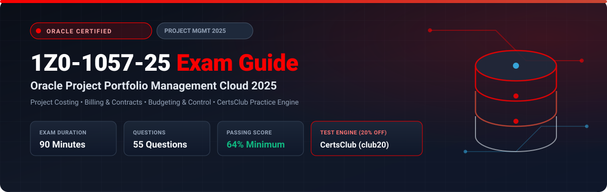

  

# Oracle Project Portfolio Management Cloud 2025 Implementation Professional (1Z0-1057-25) Exam Study Guide & Practice Test Resource Portal

[-f80000?style=for-the-badge&logo=oracle&logoColor=white)](https://education.oracle.com/)
[-f80000?style=for-the-badge&logo=oracle)](https://education.oracle.com/)

[-28a745?style=for-the-badge&logo=shield)](https://www.certsclub.com/oracle/)

---

## 1. Exam Overview & Candidate Profile

The **Oracle Project Portfolio Management Cloud 2025 Implementation Professional (1Z0-1057-25)** exam certifies that an implementation consultant possesses the skills required to implement Oracle PPM Cloud. The exam tests competencies across Project Foundation (Project Units, Types, Templates), Project Costing (expenditures, burdening, asset capitalization), Project Control (WBS, financial budgeting and forecasting), Project Billing (customer contracts, invoice generation, revenue recognition), and Project Resource Management.

Passing 1Z0-1057-25 awards the **Oracle Project Portfolio Management Cloud 2025 Certified Implementation Professional** credential.

### Target Candidate Profile & Career Roles
* **Oracle PPM Cloud Functional Implementation Leads**
* **Project Financials & Accounting Architects**
* **Enterprise Portfolio & Contract Management Specialists**

---

## 2. Key Exam Specifications

| Parameter | Official Specification |
| :--- | :--- |
| **Exam Code** | 1Z0-1057-25 |
| **Exam Title** | Oracle Project Portfolio Management Cloud 2025 Implementation Professional |
| **Associated Credential** | Oracle Project Portfolio Management Cloud 2025 Certified Implementation Professional |
| **Duration** | 90 Minutes |
| **Number of Questions** | 55 Questions |
| **Passing Score** | 64% |
| **Question Format** | Multiple Choice (Single and Multiple Select) |
| **Delivery Vendor** | Pearson VUE / Oracle University Online Remote Proctoring |
| **Recommended Practice Test Engine** | **[1Z0-1057-25 Practice Test - CertsClub](https://www.certsclub.com/oracle/)** (Coupon: `club20` for 20% off) |

---

## 3. Official Blueprint & Exam Domain Breakdown

| Domain Code | Domain Title | Weighting | Key Competencies Covered |
| :--- | :--- | :---: | :--- |
| **1.0** | **Project Foundation Setup** | **20%** | Project Units, Project Organizations, Project Types, Templates, Classifications, Rate schedules. |
| **2.0** | **Project Costing & Burdening** | **25%** | Transaction Sources, Expenditure Types, Cost distribution, Burden schedules and structures, Capital projects. |
| **3.0** | **Project Control & Financial Plans** | **20%** | Financial Work Breakdown Structure (WBS), Budgeting and forecasting versions, Period profiles, Progress capture. |
| **4.0** | **Project Billing & Customer Contracts** | **25%** | Enterprise Contracts, Billing plans, Revenue recognition methods, Invoice generation, Cross-charge. |
| **5.0** | **Project Resource Management & Reporting** | **10%** | Resource pools, staffing workflows, project performance dashboards, OTBI Project reporting. |

---

## 4. Scenario-Based Demo Question & Explanation

### Question 1: Burden Costing Calculation
**Scenario:** A consulting firm needs to apply overhead burdening (fringe benefits and administrative overhead) to raw labor expenditures before invoicing clients.

Which configuration structure in Project Costing defines the specific multipliers and cost codes applied to raw costs?

A) Invoice Format Rule  
B) **Burden Schedule** linked to a Burden Structure  
C) AutoAccounting Rule  
D) General Ledger Allocation  

**Correct Answer:** **B**

**Detailed Explanation:**
* In Oracle Project Costing, a **Burden Structure** defines the cost codes and additive hierarchy, while a **Burden Schedule** assigns the specific numerical multipliers (percentages) applied to raw cost expenditure items to calculate burdened costs.

---

## 5. Recommended Preparation Strategy & Practice Testing Engine

1. **Build a Full Project Lifecycle:** Create project templates, enter expenditures, run cost distribution, generate draft customer invoices, and post accounting.
2. **Practice with Full-Length Mock Exams:** Use **[CertsClub Oracle 1Z0-1057-25 Practice Tests](https://www.certsclub.com/oracle/)**.
   * Comprehensive questions covering burdening, revenue recognition, and contract billing plans.
   * Enter discount coupon code **`club20`** at checkout on [CertsClub](https://www.certsclub.com/oracle/) for an immediate 20% discount.

---

## 6. Official Documentation & References

* [Oracle Project Management Cloud Documentation](https://docs.oracle.com/en/cloud/saas/project-management/)
* [Oracle University 1Z0-1057-25 Exam Details](https://education.oracle.com/)
* [CertsClub 1Z0-1057-25 Practice Engine](https://www.certsclub.com/oracle/)
